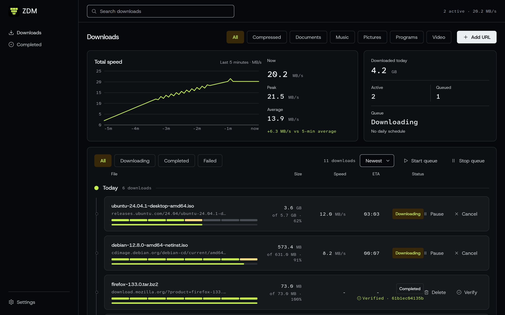
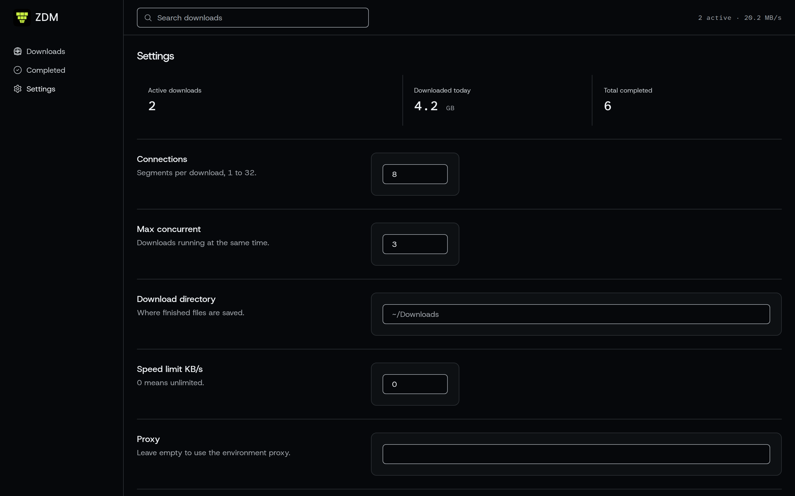

# ZDM — ZDM Download Manager

[](https://github.com/zulian026/zdm/releases/latest)
[](LICENSE)
[](https://github.com/zulian026/zdm/releases/latest)
[](https://v2.tauri.app/)
[](https://www.rust-lang.org/)

ZDM is a download manager for Linux, built with [Tauri v2](https://v2.tauri.app/) and Rust. It downloads files in parallel segments over HTTP(S), resumes interrupted downloads from where they stopped, verifies what it downloaded, and stays out of the way in the system tray. It is a clean-room implementation, inspired by the observed behaviour of classic download managers — no third-party code, binaries, strings, or trademarks are used.



## Features

### Downloads

- **Dynamic segmentation** — each download is split into segments (8 by default, configurable from 1 to 32) fetched in parallel with HTTP `Range` requests. When a worker finishes its segment, it splits the largest remaining segment and takes the second half, so fast connections steal work from slow ones. Segments smaller than 128 KiB are never split.
- **Resume that actually works** — segment offsets persist to a JSON sidecar (`<file>.download.json`) and a SQLite registry, so a paused, crashed, or killed download continues from its saved offsets instead of starting over. Auto-resume on startup is on by default; manually paused downloads stay paused.
- **Queue** — up to 3 concurrent downloads by default, with Start/Stop Queue, Pause All, and per-download pause, resume, cancel, and delete.
- **Categories** — files are sorted by type (Documents, Music, Video, Pictures, Programs, Compressed, General) into folders under `~/Downloads/ZDM/`.
- **Speed limit** — a global token-bucket limiter (KB/s, 0 means unlimited), shared by all workers.
- **Retry and proxies** — up to 5 retries with exponential backoff; proxy from settings or the `HTTP_PROXY`/`HTTPS_PROXY` environment variables; Basic auth embedded in the URL is sent as an `Authorization` header.
- **Live overview** — a 5-minute speed graph with now/peak/average, a per-day download timeline with a day scrubber, and Completed filters by category, date, and text search.

### Verification and safety

- **Checksum verification** — finished downloads are hashed with SHA-256 (MD5 when the source provides it). The expected hash comes, in priority order, from a hash you type in, the server's `Digest` / `Content-Digest` / `Content-MD5` headers, or a `<url>.sha256` / `<url>.md5` sidecar. A match shows as Verified; a mismatch fails the download but keeps the file, and a `Verify` action re-hashes it on disk. A download with no hash source is never failed for lacking one.
- **ClamAV scan** — finished downloads are scanned in the background with `clamscan` when it is installed. A clean file shows Clean; a detection fails the download ("Virus terdeteksi") and keeps the file. A missing scanner never fails a download. The scan can be toggled off in Settings, and a `Scan` action re-scans on demand.
- **Desktop notifications** — one notification per finished or failed download, plus a summary when the queue drains with two or more completions. Notifications are only sent when the window is not focused, minimised, or hidden to the tray; clicking one brings ZDM to the front.
- **System tray** — left-click shows or hides the window; the menu offers Show/Hide, Add URL, Start/Stop Queue, Pause All, and Quit. Closing or minimising the window hides it to the tray instead of quitting (both can be turned off in Settings).

### Media

- **Site Grabber** — paste a page URL and ZDM lists its downloadable media (`<video>`, `<audio>`, `<source>`) and file links, each labelled by kind with a HEAD-probed size. `blob:` and `data:` sources are skipped.
- **HLS / DASH merging** — a `.m3u8` or `.mpd` URL is not saved as a playlist. ZDM downloads every segment in parallel (with resume — finished segments are never re-downloaded) and merges them into one playable video: `.mp4` when ffmpeg is available (`.ts` for HLS without it). It picks the best variant / adaptation sets, supports AES-128-encrypted HLS through ffmpeg, and only handles video on demand — live streams are rejected. DASH without ffmpeg downloads the playlist only, with a note saying so.

### Automation

- **Daily schedule** — a recurring queue window (start/stop time, weekdays, default 23:00–06:00 every day, off by default). While ZDM is running, the queue starts when the window opens and pauses — never cancels — when it closes; overnight windows work. A one-shot scheduled start is also available. The schedule only runs while ZDM is running.
- **Autostart** — "Start ZDM when I log in" (off by default) installs an app-menu entry and an autostart entry that launches ZDM hidden in the tray (`--minimized`), so the daily schedule can fire overnight.
- **Browser integration** — extensions for Chromium and Firefox intercept downloads automatically: the browser download is cancelled and the URL is handed to ZDM through a native host. With "Ask before downloading" on (the default), intercepted URLs wait in a confirmation popup showing filename, URL, size, folder, category, and connections, instead of auto-starting. The extension also adds a floating "Download with ZDM" button and a context-menu entry on pages with media. See [`browser/README.md`](browser/README.md).

### Updates

- **Built-in update checker** — ZDM fetches a remote manifest JSON (`version`, `download_url`, `sha256`, `changelog`) and offers a newer version in a banner above the Downloads grid, with Download and Dismiss. It checks once a day at startup and on demand from Settings ("Check for updates"). The manifest URL defaults to the latest release of this repository, so it stays correct across releases. An update is downloaded through the normal engine, so it gets checksum verification against the manifest SHA-256 like any download. ZDM never replaces its own running binary — after the download finishes it shows where the file is and the manual replacement steps. Check state lives in `~/.config/zdm/update_state.json`.

## Installation

Linux (x86_64) only. Get the latest release from the
[Releases page](https://github.com/zulian026/zdm/releases/latest) — each release ships the AppImage, the standalone binary, and a `version.json` manifest.

**AppImage (recommended):**

```bash
chmod +x ZDM_0.1.1_amd64.AppImage
./ZDM_0.1.1_amd64.AppImage
```

**Standalone binary:**

```bash
./zdm
```

The AppImage may print a harmless WebKitGTK/GStreamer warning on startup; the standalone binary runs without it. On first run ZDM creates `~/.config/zdm/settings.json` and downloads go to `~/Downloads/ZDM/` by default.

## Usage

- **Add URL** — the Add URL button opens a dialog with the URL, an optional expected SHA-256, a batch field (one URL per line), and the Site Grabber. A download starts immediately; intercepted browser downloads wait for confirmation instead when "Ask before downloading" is on.
- **Queue** — Start queue / Stop queue in the Downloads toolbar, Pause All in the tray menu. Each row has pause, resume, cancel, and delete; completed rows offer Verify and Scan.
- **Browser extension** — run `./browser/install.sh` to register the native host, then load the extension once per browser: Chromium → `chrome://extensions` → Load unpacked → `browser/chromium`; Firefox → `about:debugging` → Load Temporary Add-on → `browser/firefox/manifest.json`. The Firefox add-on is temporary and is lost on browser restart; a permanent install needs a signed AMO package.
- **Schedule** — Settings → Daily schedule: enable it, pick start/stop times and weekdays. The next event is shown in Settings and in the Downloads toolbar.
- **Updates** — Settings → Update manifest URL (pre-filled with the latest release) and "Check for updates". Dismiss hides a version until a newer one appears.



## Building from source

Prerequisites: [Node.js](https://nodejs.org/) 18+, a recent stable Rust toolchain ([rustup](https://rustup.rs/)), and the Tauri system dependencies for Linux.

```bash
# Ubuntu / Debian
sudo apt install libwebkit2gtk-4.1-dev build-essential curl wget file \
  libxdo-dev libssl-dev libayatana-appindicator3-dev librsvg2-dev \
  libgtk-3-dev libsoup-3.0-dev patchelf

# Arch / CachyOS
sudo pacman -S webkit2gtk-4.1 gtk3 libayatana-appindicator librsvg \
  base-devel patchelf libsoup3
```

```bash
git clone https://github.com/zulian026/zdm.git
cd zdm
npm install
npm run tauri dev    # dev: Vite on :1420 + Tauri window
npm run tauri build  # release: src-tauri/target/release/zdm
                     # bundles (AppImage, .deb, .rpm) under
                     # src-tauri/target/release/bundle/
```

Tests:

```bash
cd src-tauri
cargo test           # 127 tests: 99 unit + 28 integration
```

## Project structure

```
.
├── index.html               # Vite entry
├── package.json             # frontend deps (Vite, @tauri-apps/cli, @tauri-apps/api)
├── src/                     # frontend: main.ts, styles.css, tokens.css, base.css, icons.ts
├── src-tauri/
│   ├── Cargo.toml
│   ├── tauri.conf.json      # app metadata, version, bundle targets
│   ├── icons/               # app + tray icons
│   ├── src/                 # Rust backend (see docs/ARCHITECTURE.md)
│   └── tests/               # download_integration.rs (local Range server)
├── browser/                 # Chromium/Firefox extensions + native host + install.sh
├── updates/                 # version.json (release manifest), make-manifest.py
├── docs/
│   ├── ARCHITECTURE.md
│   └── images/              # screenshots
├── design.md                # locked design system (tokens, shell, signature)
└── zdm.desktop              # app-menu entry
```

## Configuration and data

| Path | What it holds |
| --- | --- |
| `~/.config/zdm/settings.json` | All settings (connections, queue, schedule, toggles, manifest URL) |
| `~/.config/zdm/update_state.json` | Last update check, dismissed version |
| `~/Downloads/ZDM/` | Default download directory (changeable in Settings) |
| `~/Downloads/ZDM/downloads.db` | SQLite registry of all downloads |
| `~/Downloads/ZDM/<file>.part` | In-progress download data |
| `~/Downloads/ZDM/<file>.download.json` | Per-download resume state (segment offsets) |
| `~/Downloads/ZDM/queue.json` | URLs handed over by the browser extension |
| `~/.local/share/applications/zdm.desktop` | App-menu entry (installed when autostart is on) |
| `~/.config/autostart/zdm.desktop` | Autostart entry (installed when autostart is on) |
| `~/.cache/zdm/icon.png` | Cached icon used by notifications |

## Contributing

See [CONTRIBUTING.md](CONTRIBUTING.md). Bug reports and pull requests are welcome — please include how to reproduce, and run `cargo test` before submitting.

## License

ZDM is released under the [MIT License](LICENSE).

## Acknowledgements

- Clean-room implementation: ZDM was written from scratch, guided by the observed behaviour of classic download managers and the public HTTP Range specification ([RFC 9110](https://www.rfc-editor.org/rfc/rfc9110.html)). No IDM code, binaries, strings, or trademarks are used or copied.
- Built with [Tauri v2](https://v2.tauri.app/) and Rust.
- An earlier Python prototype of the same idea preceded this port.
